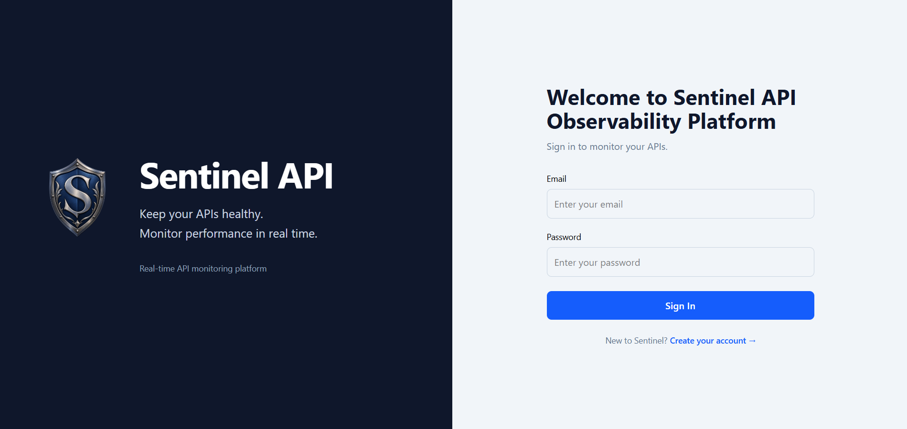
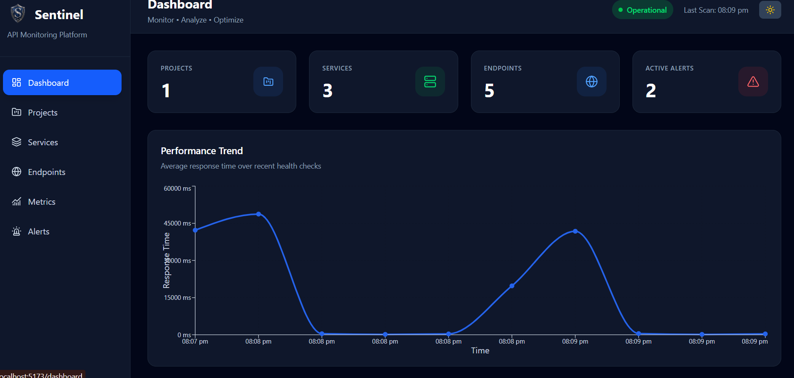
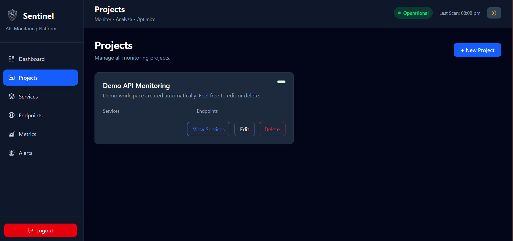
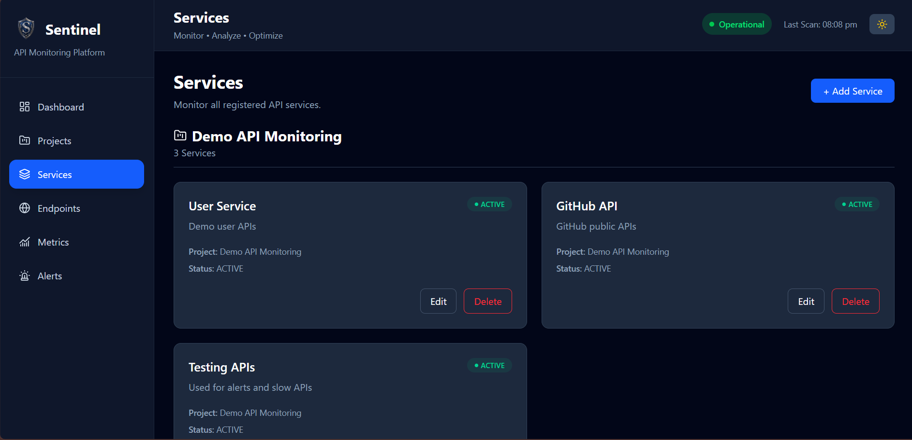
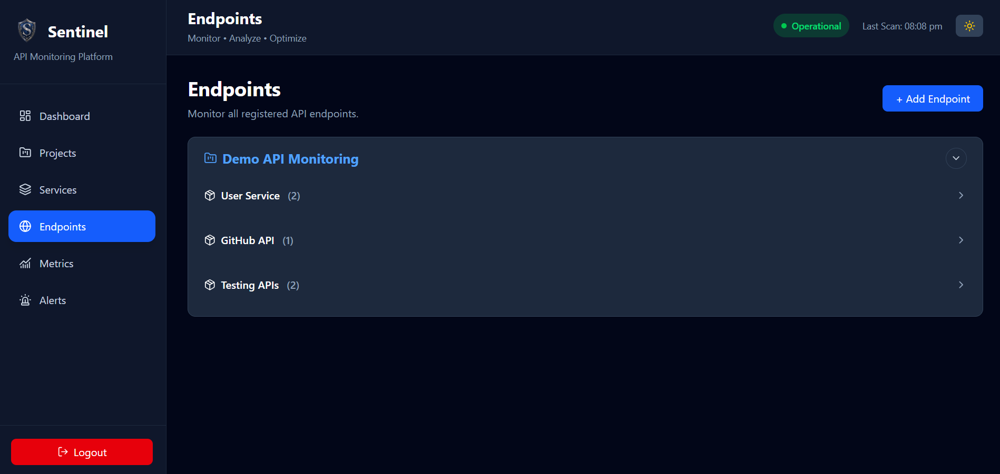
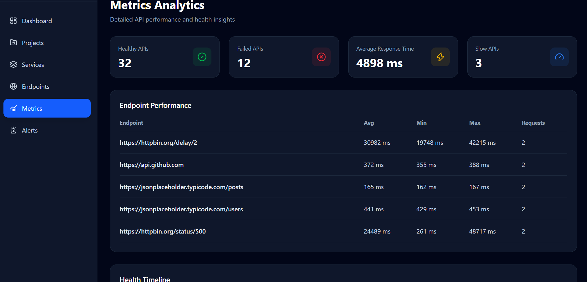
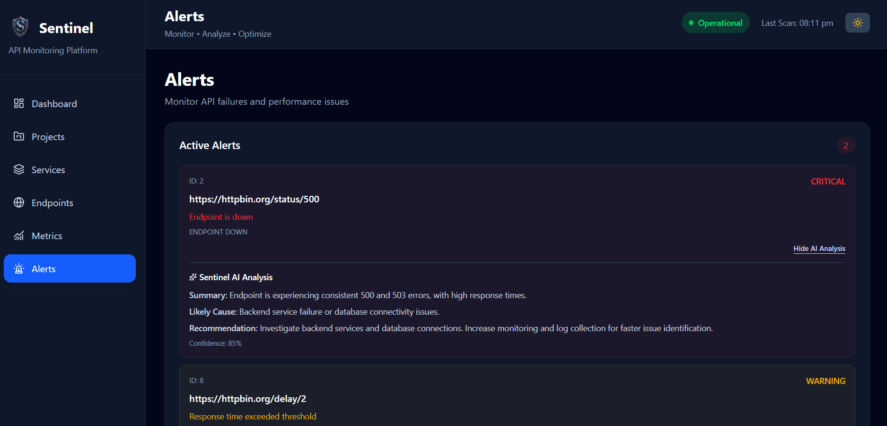

# 🚀 Sentinel API Monitoring Dashboard

> **Monitor. Analyze. Optimize.**

> Sentinel is a full-stack API Monitoring Dashboard that helps developers and organizations monitor API availability, response time, uptime, and overall health through an intuitive and interactive dashboard.

---

## 📖 Overview

Modern applications rely heavily on APIs. A single failing endpoint can affect the entire system.

**Sentinel** provides a centralized platform to monitor APIs in real time, visualize performance metrics, and quickly identify failures before they impact users.

Whether you're testing your own APIs or monitoring production services, Sentinel gives you valuable insights through analytics, health checks, and alerts.

---

# ✨ Features

### 🔐 Authentication
- Secure JWT-based Login & Registration
- Protected Routes
- Session Management



### 📊 Real-Time Dashboard

- Health Overview
- Performance Analytics
- Projects & Services
- Endpoint Management
- Statistics Cards
- Slow API Detection
- Alert Management
- AI Incident Analysis
- Dark Mode



### 📁 Project Management
- Create multiple monitoring projects
- Organize APIs by project
- Edit and Delete projects



### 🔧 Service Management
- Create and manage API services within projects
- Group services based on their associated project
- Add, update, and delete services
- Monitor the health and performance of each service
- Easily navigate between projects and their services



### 🌐 Endpoint Management
- Add API endpoints
- Configure request method
- Set monitoring intervals
- Enable/Disable endpoints
- Edit endpoint details
- Delete endpoints



### 📊 Metrics Management
- Track API response time and performance metrics
- Monitor request success and failure rates
- View historical performance data through interactive charts
- Analyze response time trends for monitored endpoints
- Identify slow-performing APIs and endpoints
- Monitor overall API health and availability



### 🚨 Alert Management
- API Failure Detection
- Slow Response Detection
- Status Monitoring
- Alert History




### 🤖 AI Features

- AI-powered anomaly detection
- Failure prediction using historical metrics
- Intelligent API health insights
- Root cause suggestions
- Performance optimization recommendations


---

# 🛠 Tech Stack

## Frontend

- React
- Vite
- Tailwind CSS
- Axios
- React Router
- Recharts

## Backend

- Spring Boot
- Spring Security
- JWT Authentication
- Spring Data JPA
- Hibernate

## Database

- H2 Database (Development)

## Tools

- Postman
- Git
- GitHub
- IntelliJ IDEA
- VS Code

---

# ⚙️ Installation

## 1. Clone Repository

```bash
git clone https://github.com/your-username/Sentinel_API.git
```

```
cd Sentinel_API
```

---

## 2. Backend Setup

Run the Spring Boot application.

### Windows

```bash
gradlew bootRun
```

### Linux / macOS

```bash
./gradlew bootRun
```

Backend starts on

```
http://localhost:8080
```

---

## 3. Frontend Setup

Navigate to frontend.

```bash
cd sentinel-api-frontend
```

Install dependencies.

```bash
npm install
```

Start development server.

```bash
npm run dev
```

Frontend starts on

```
http://localhost:5173
```

---

# 🔑 Default Configuration

Backend

```
Port : 8080
Database : H2
```

Frontend

```
Port : 5173
```

---

# 📊 Dashboard Modules

- Health Overview
- Performance Charts
- Alerts
- Projects
- Endpoint Manager
- Statistics Cards
- Slow API Table

---

# 🚀 Upcoming Features

### 🔔 Smart Notifications

- Email Alerts
- Slack Notifications
- Microsoft Teams Integration
- Discord Notifications

---

### 📱 Mobile Friendly Dashboard

- Better Responsive Layout
- Tablet Support
- Progressive Web App (PWA)

---

### 📈 Advanced Analytics

- Weekly Reports
- Monthly Reports
- API Trends
- Failure Prediction
- Response Time Comparison

---

### 🔒 Security

- Refresh Tokens
- Two-Factor Authentication (2FA)
- Password Reset
- Account Verification

---

# 📌 API Workflow

```
User
   │
   ▼
Login / Signup
   │
   ▼
JWT Authentication
   │
   ▼
Create Project
   │
   ▼
Add API Endpoints
   │
   ▼
Scheduler Monitors APIs
   │
   ▼
Metrics Stored
   │
   ▼
Dashboard Visualization
   │
   ▼
Alerts Generated
```

---

# 💡 Why Sentinel?

✔ Easy to use

✔ Modern UI

✔ Real-time Monitoring

✔ Performance Analytics

✔ Secure Authentication

✔ Interactive Charts

✔ Expandable Architecture

✔ Developer Friendly

---

# 🤝 Contributing

Contributions are welcome!

1. Fork the repository.
2. Create a feature branch.
3. Commit your changes.
4. Push your branch.
5. Open a Pull Request.

---

# 👩‍💻 Author

**Sonakshi Chowgule**

Computer Science Engineering Student

Passionate about Full-Stack Development, AI, and Cloud Technologies.

---

## ⭐ Support

If you found this project useful, consider giving it a ⭐ on GitHub.

It motivates future development and helps others discover the project.
