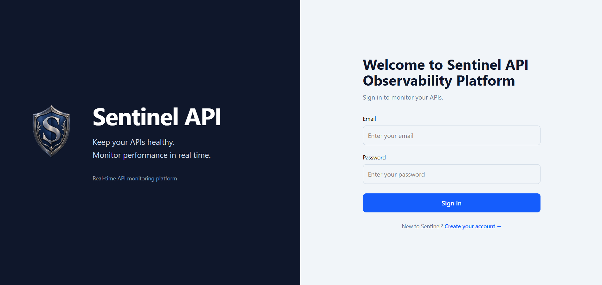
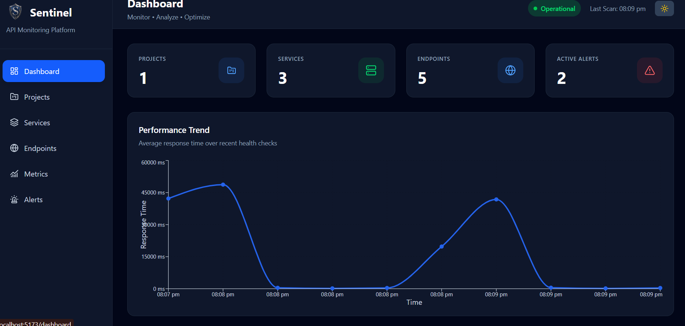
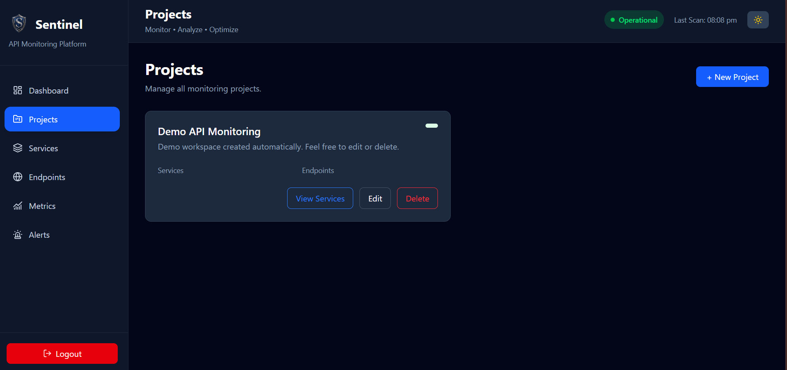
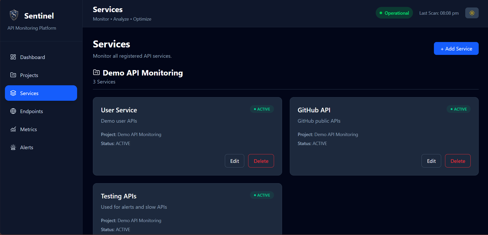
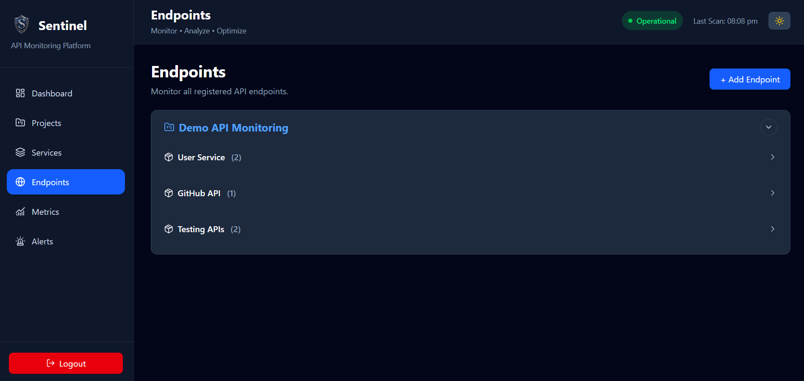
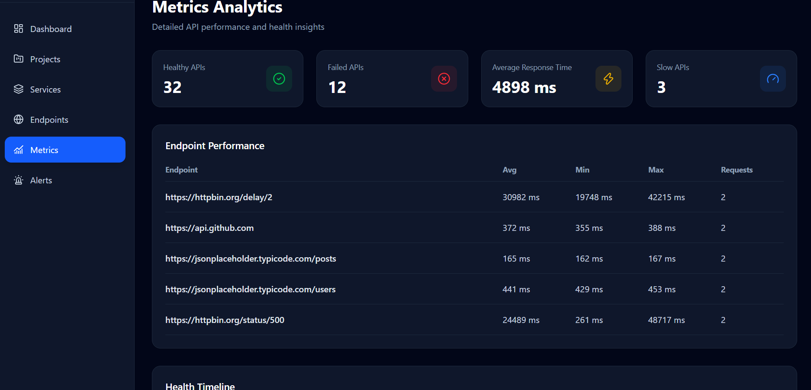
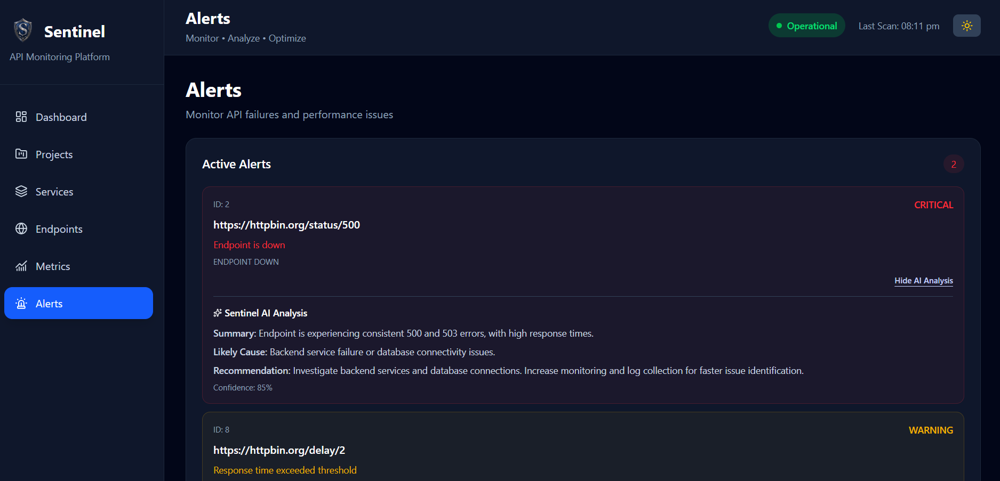

# 🚀 Sentinel API Monitoring Dashboard

[](LICENSE)
[](https://spring.io/projects/spring-boot)
[](https://react.dev/)
[](https://tailwindcss.com/)
[](https://ollama.ai/)

> **Monitor. Analyze. Optimize.**

**Sentinel** is a full-stack API Monitoring Dashboard that enables developers and organizations 
to track API availability, response times, HTTP status codes, and overall endpoint health through an intuitive,
interactive interface enhanced with AI-driven incident analysis.

---

## 📖 Overview

Modern applications rely heavily on interconnected microservices and APIs. A single failing endpoint can cause cascading failures across your infrastructure.

**Sentinel** provides a centralized monitoring platform to:

* Monitor APIs continuously with automated scheduled background checks.
* Visualize latency trends, success rates, and endpoint availability.
* Detect slow and failed endpoints based on configurable monitoring conditions.
* Generate automated alerts for endpoint failures and high latency.
* Analyze incidents using localized AI powered by Ollama and Qwen 2.5.
* Organize monitored APIs through projects, services, and endpoints.

---

## ✨ Features

### 🔐 Authentication & Security

* Secure JWT-based registration and login
* Protected application routes and API endpoints
* User session state management



### 📊 Real-Time Dashboard

* **Health Overview**: Current endpoint health across monitored APIs
* **Performance Analytics**: Response-time and health information from recorded checks
* **Slow API Detection**: Automatically identifies endpoints with response times above 1000 ms
* **Incident Summary**: Active alert and health-status overview
* **Live Updates**: Authenticated server-sent events refresh dashboard and metrics without periodic polling
* **Health Visualization**: Healthy and failed checks are distinguished on the response-time chart
* **Dark Mode UI**: Modern dark-themed monitoring interface



### 📁 Project Management

* Organize APIs into distinct business projects
* Full CRUD management for projects
* Associate monitored services with projects



### 🔧 Service Management

* Create and manage logical API services within projects
* Group endpoints by service or application component
* Track service-level endpoint health



### 🌐 Endpoint Management

* Register HTTP/HTTPS API endpoints (`GET`, `POST`, `PUT`, `DELETE`, `PATCH`)
* Configure endpoint timeout limits
* Enable or disable individual endpoints for monitoring
* Associate endpoints with monitored services



### 📊 Metrics Management

* Track response time, HTTP status codes, timestamps, and success state
* Store historical metrics for every monitoring execution
* Retrieve endpoint-specific metric history with pagination and date-range filters
* Calculate p50, p90, p95, and p99 latency percentiles
* Calculate monitoring-check throughput, error rate, uptime, and availability over a selected period
* Compare the selected period with the immediately preceding period of equal duration
* Configure endpoint SLO targets of 99%, 99.9%, or 99.95%
* Generate rolling 7-day, 30-day, and 90-day SLO compliance reports
* Calculate allowed failed checks, error-budget consumption and remaining budget, and error-budget burn rate
* Identify slow API responses above the 1000 ms threshold
* Calculate average response time across successful checks
* Calculate current healthy and failed endpoint counts based on the latest health state
* Retrieve the latest monitoring records
* Calculate endpoint-specific historical response-time baselines
* Detect statistical latency anomalies using configurable sensitivity
* Explain anomalies with average, standard deviation, threshold, and deviation data

### Service Dependency Mapping

* Define directional dependencies between services in the same project
* Prevent self-dependencies, duplicates, cross-project relationships, and circular graphs
* View project dependency graphs with service health status
* Analyze direct, indirect, confirmed, and potentially affected services
* Inspect dependency relationships from the `/dependencies` frontend page



### 🔭 Observability and Notifications

* Request correlation IDs returned in the `X-Correlation-ID` response header and included in request-scoped logs
* Distributed tracing with Micrometer Tracing (Brave) and optional Zipkin span export
* Prometheus metrics through the protected `/actuator/prometheus` endpoint
* Endpoint-check counters and response-time histograms with low-cardinality labels
* Optional asynchronous HTTP webhook notifications for alert creation and resolution
* User-scoped SSE updates for Dashboard, Metrics, and Alerts views

See [Observability Configuration](./docs/observability.md) for tracing, metrics, and webhook settings.

### 🚨 Alert Management

* Automated incident detection for failed and slow endpoints
* Severity categorization (`LOW`, `MEDIUM`, `HIGH`, `CRITICAL`)
* Active and resolved alert tracking
* Alert history with resolution status
* Evidence-based `ANOMALY_DETECTED` alerts with duplicate suppression and automatic resolution
* Optional asynchronous webhook delivery for alert creation and resolution



### 🤖 AI Incident Analysis

* **Incident Context Building**: Builds analysis context from alert and monitoring data
* **Root Cause Analysis**: Generates possible causes and recommended actions
* **Confidence Scoring**: Provides a confidence value for diagnostic insights
* **Local Model Execution**: Uses Ollama with `qwen2.5:7b` for local AI inference

---

## 🛠 Tech Stack

### Frontend

* **Framework**: React 19 with Vite 8
* **Styling**: Tailwind CSS 4
* **HTTP Client**: Shared Axios client configured by `VITE_API_BASE_URL`
* **Routing**: React Router DOM
* **Charts**: Recharts
* **Icons**: Lucide React

### Backend

* **Language**: Java 21
* **Framework**: Spring Boot 3.x
* **Security**: Spring Security, JWT (JSON Web Tokens)
* **Persistence**: Spring Data JPA, Hibernate
* **HTTP Client**: Spring `RestTemplateBuilder` with Micrometer observation instrumentation
* **Observability**: Spring Boot Actuator, Micrometer Prometheus, Micrometer Tracing, Zipkin reporter
* **Documentation**: OpenAPI / Swagger (SpringDoc UI)
* **Scheduling**: Spring Scheduled Tasks and async webhook notification executor

### Database

* **Primary**: PostgreSQL
* **Development / In-Memory**: H2 Database support

### AI Engine

* **Local LLM Runner**: Ollama
* **Model**: `qwen2.5:7b`

---

## 📁 Project Structure

```text
Sentinel_API/
├── backend/
│   ├── src/main/java/org/example/
│   │   ├── config/                  # Security, async notifications, application configuration
│   │   ├── controller/              # REST and SSE controllers
│   │   ├── dto/                     # API and webhook DTOs
│   │   ├── entity/                  # JPA entities
│   │   ├── notification/            # Optional alert webhook delivery
│   │   ├── observability/           # Custom Micrometer metrics
│   │   ├── realtime/                # User-scoped SSE event delivery
│   │   ├── repository/              # Spring Data repositories
│   │   ├── scheduler/               # Scheduled endpoint monitoring
│   │   ├── security/                # JWT and URL validation
│   │   ├── service/                 # Service interfaces and domain services
│   │   └── serviceImplDb/           # Database-backed implementations
│   ├── src/main/resources/
│   │   ├── db/migration/            # Flyway schema migrations
│   │   └── application.yaml
│   ├── Dockerfile
│   └── build.gradle
├── frontend/
│   ├── src/
│   │   ├── api/                     # Shared Axios client and JWT interceptor
│   │   ├── components/
│   │   ├── pages/
│   │   └── services/                # Frontend API and SSE clients
│   ├── vercel.json                 # SPA route rewrites
│   └── package.json
├── docs/                           # Observability, deployment, and recovery runbooks
├── scripts/                        # Authenticated production smoke checks
└── .github/workflows/              # Backend, frontend, and optional deploy workflows
```

## 📋 Prerequisites

Before running Sentinel API, ensure you have installed:

* **Java Development Kit (JDK 21 or later)**: `java -version`
* **Node.js (v22.12 or later) & npm**: `node -v` and `npm -v`
* **PostgreSQL Database** (or Neon for production)
* **Docker** (for building the backend container)
* **Ollama** (optional for local AI Incident Analysis)

---

## ⚙️ Installation & Setup Guide

### 1. Clone Repository

```bash
git clone https://github.com/chowgulesonakshi-lab/Sentinel_API.git
cd Sentinel_API
```

---

### 2. AI Engine Setup (Ollama)

To enable AI Incident Analysis:

1. Install [Ollama](https://ollama.ai/).

2. Pull the Qwen 2.5 7B model:

   ```bash
   ollama pull qwen2.5:7b
   ```

3. Start the Ollama server:

   ```bash
   ollama serve
   ```

The default Ollama server runs on port `11434`.

---

### 3. Backend Setup

The backend project is in `backend/`. Configure the database and JWT secret using environment variables or your IDE run configuration. Do not commit local `.env` files or credential values.

Important production settings:
- `DB_URL`, `DB_USERNAME`, and `DB_PASSWORD` configure PostgreSQL.
- `JWT_SECRET` must be set to a long random value in production.
- `CORS_ALLOWED_ORIGINS` is an explicit comma-separated origin allow-list.
- Flyway applies schema migrations; Hibernate uses `ddl-auto: validate`.

Run the backend from the repository root:

#### Windows

```powershell
cd backend
.\gradlew.bat bootRun
```

#### Linux / macOS

```bash
cd backend
./gradlew bootRun
```

The backend listens on `http://localhost:8080` by default.

### 4. Frontend Setup

The React/Vite project is in `frontend/`.

```powershell
cd frontend
npm ci
npm run dev
```

The frontend starts at `http://localhost:5173`. Local development defaults to the backend at `http://localhost:8080`; configure `VITE_API_BASE_URL` when using a different backend origin.

## 🔑 Default Configuration & Environment Variables

Backend environment variables are read by Spring Boot. No production password or JWT signing secret is hard-coded.

| Variable | Default | Description |
| :--- | :--- | :--- |
| `PORT` | `8080` | HTTP server port; Railway injects this in production |
| `DB_URL` | Local PostgreSQL JDBC URL | JDBC URL; use Neon's pooled endpoint with `sslmode=require` for the application |
| `DB_USERNAME` | `postgres` | Database username |
| `DB_PASSWORD` | Empty | Database password; required outside local development |
| `JWT_SECRET` | Empty | JWT signing secret; must be configured in production |
| `CORS_ALLOWED_ORIGINS` | Local Vite origins | Comma-separated exact frontend origins |
| `DB_POOL_MAX_SIZE` | `10` | Hikari maximum pool size; use a smaller value with Neon pooling |
| `DB_POOL_MIN_IDLE` | `2` | Hikari minimum idle connections |
| `SENTINEL_AI_ENABLED` | `true` | Enable AI provider integration |
| `SENTINEL_AI_BASE_URL` | `http://localhost:11434` | Ollama-compatible provider URL |
| `SENTINEL_AI_MODEL` | `qwen2.5:7b` | AI model name |
| `TRACING_SAMPLING_PROBABILITY` | `0.1` | Distributed trace sampling probability |
| `ZIPKIN_ENDPOINT` | Local Zipkin endpoint | Zipkin v2 collector URL |
| `ALERT_WEBHOOK_ENABLED` | `false` | Enable asynchronous alert webhook delivery |
| `ALERT_WEBHOOK_URL` | Empty | Public webhook receiver URL; keep secret URLs in platform variables |

Frontend environment:

| Variable | Default | Description |
| :--- | :--- | :--- |
| `VITE_API_BASE_URL` | `http://localhost:8080` | Backend origin used by Axios and the SSE client |

Vite variables are public in the browser bundle. Never put database credentials, JWT signing secrets, or private webhook URLs in a `VITE_*` variable.

Environment templates: [backend/.env.example](./backend/.env.example) and [frontend/.env.example](./frontend/.env.example).

### Deployment runbooks

- [Neon + Railway backend deployment](./docs/deployment-neon-railway.md)
- [Vercel frontend deployment](./docs/deployment-vercel.md)
- [Observability and alert webhooks](./docs/observability.md)
- [Production backup and recovery](./docs/backup-recovery.md)
- [CI/CD and production launch checklist](./docs/production-launch.md)

## 📡 REST API Reference

The backend provides RESTful endpoints. Swagger documentation is available interactively at `http://localhost:8080/swagger-ui.html` when the application is running.

### 🔐 Authentication (`/`)

* `POST /signup` - Register a new user account
* `POST /login` - Authenticate user and receive JWT bearer token

### 📊 Dashboard (`/dashboard`)

* `GET /dashboard` - Retrieve aggregated dashboard metrics summary
* `GET /dashboard/recent-metrics` - Get recent health-check records
* `GET /dashboard/health` - Retrieve current health information per endpoint

### 📁 Projects (`/projects`)

* `GET /projects` - List all monitoring projects
* `GET /projects/{id}` - Fetch project details by ID
* `GET /projects/user/{ownerId}` - List projects by owner user ID
* `POST /projects` - Create a new project
* `PUT /projects/{id}` - Update project metadata
* `DELETE /projects/{id}` - Remove a project

### 🔧 Services (`/services`)

* `GET /services` - List all monitored API services
* `GET /services/project/{projectId}` - List services associated with a project
* `POST /services` - Register a new API service
* `PUT /services/id/{id}` - Update service configuration
* `DELETE /services/id/{id}` - Delete an API service

### 🌐 Endpoints (`/endpoints`)

* `GET /endpoints` - Fetch all configured target endpoints
* `GET /endpoints/{id}` - Get endpoint details by ID
* `GET /endpoints/service/{serviceId}` - Fetch endpoints under a specific service
* `POST /endpoints` - Add a new API endpoint for monitoring
* `PUT /endpoints/{id}` - Update endpoint monitoring settings
* `DELETE /endpoints/{id}` - Remove an endpoint from monitoring

### 📊 Metrics (`/metrics`)

* `GET /metrics` - List all historical metric execution records
* `GET /metrics/{id}` - Get a metric record by ID
* `GET /metrics/endpoint/{endpointId}` - Get metric history for an endpoint
* `GET /metrics/endpoint/{endpointId}/history?from={ISO_DATE_TIME}&to={ISO_DATE_TIME}&page=0&size=50` - Get paginated endpoint history with optional date filters (defaults to the last 24 hours)
* `GET /metrics/analytics?endpointId={id}&from={ISO_DATE_TIME}&to={ISO_DATE_TIME}` - Get latency percentiles, throughput, error rate, uptime, availability, and equal-period historical comparisons (endpointId is optional; defaults to the last 24 hours)
* `PUT /slos/endpoints/{endpointId}/target` - Configure an endpoint SLO target with JSON body `{"targetPercentage":99.9}` (supported values: 99, 99.9, 99.95)
* `GET /slos/endpoints/{endpointId}/report` - Return rolling 7-day, 30-day, and 90-day availability, compliance, error-budget, and burn-rate reports
* `GET /metrics/endpoint/{endpointId}/latest` - Get the latest metric for an endpoint
* `GET /metrics/slow` - List metric records exceeding the specified response-time threshold
* `GET /metrics/status/{statusCode}` - Get metrics matching an HTTP status code
* `GET /metrics/latest` - Get the 10 most recent metric records
* `GET /metrics/average-response-time` - Get average response time across successful checks
* `GET /metrics/up-count` - Count endpoints whose latest health state is UP
* `GET /metrics/down-count` - Count endpoints whose latest health state is DOWN
* `GET /metrics/failed-count` - Count historical failed metric checks
* `GET /metrics/slow-count` - Count endpoints whose latest response time exceeds 1000 ms
* `GET /metrics/last-health-check` - Get the timestamp of the latest recorded health check

Metrics responses include anomaly evaluation data when enough valid endpoint history exists, including the historical average, standard deviation, detection threshold, deviation, sensitivity, observation count, and explanation.

### Alert Rules (`/alert-rules`)

* `GET /alert-rules` - List configured alert rules
* `GET /alert-rules/{id}` - Retrieve an alert rule
* `GET /alert-rules/endpoint/{endpointId}` - List rules for an endpoint
* `GET /alert-rules/service/{serviceId}` - List rules for a service
* `POST /alert-rules` - Create an alert rule
* `PUT /alert-rules/{id}` - Update an alert rule
* `DELETE /alert-rules/{id}` - Delete an alert rule
* `PATCH /alert-rules/{id}/toggle` - Enable or disable a rule

### 🚨 Alerts (`/alerts`)

* `GET /alerts` - List all system alerts
* `GET /alerts/active` - Fetch active unresolved incident alerts
* `GET /alerts/resolved` - Fetch historical resolved alerts
* `GET /alerts/recent` - Get recent alert log feed
* `GET /alerts/critical-count` - Count critical alerts

Anomaly alerts include the observed latency, historical average, standard deviation, calculated threshold, deviation from baseline, sensitivity multiplier, and detection explanation.

### Real-time Events and Actuator

* `GET /events/stream` - Authenticated server-sent event stream for the current user's monitoring updates
* `GET /actuator/health/readiness` - Readiness probe
* `GET /actuator/prometheus` - Prometheus metrics endpoint (protected by JWT authentication)

### Service Dependencies (`/service-dependencies`)

* `POST /service-dependencies` - Create a service dependency
* `PUT /service-dependencies/{id}` - Update a dependency
* `DELETE /service-dependencies/{id}` - Remove a dependency
* `GET /service-dependencies/project/{projectId}` - List project dependencies
* `GET /service-dependencies/service/{serviceId}` - List dependencies for a service
* `GET /service-dependencies/project/{projectId}/graph` - Retrieve the complete project graph with service health
* `GET /service-dependencies/project/{projectId}/impact/{serviceId}` - Analyze direct and indirect dependency impact

### 🤖 AI Incident Analysis (`/ai`)

* `POST /ai/analyze/{alertId}` - Analyze alert context using Ollama and retrieve diagnostic insights
* `POST /ai/incidents/{id}/analysis` - Analyze incident evidence and recurring patterns
* `POST /ai/incidents/{id}/postmortem` - Generate an evidence-backed incident postmortem
* `POST /ai/incidents/query` - Query the authenticated user's incident records

---

## 📌 API Monitoring Workflow

```text
       +-------------------+
       |    User Login     |
       +---------+---------+
                 |
                 v
       +-------------------+
       | JWT Auth Verified |
       +---------+---------+
                 |
                 v
   +---------------------------+
   | Create Project & Service  |
   +-------------+-------------+
                 |
                 v
   +---------------------------+
   | Configure Target Endpoints|
   +-------------+-------------+
                 |
                 v
   +-----------------------------+
   | Background Scheduler Engine |
   |   (Periodic HTTP Checks)    |
   +-------------+---------------+
                 |
        +--------+--------+
        |                 |
        v                 v
+---------------+ +---------------+
| Metrics Stored| | Alerts Checked|
+-------+-------+ +-------+-------+
        |                 |
        +--------+--------+
                 |
                 v
   +---------------------------+
   |  Latest Endpoint Health   |
   |  & Performance Analysis   |
   +-------------+-------------+
                 |
                 v
   +---------------------------+
   | Real-Time Dashboard View  |
   +-------------+-------------+
                 |
                 v
   +---------------------------+
   |  AI Incident Analysis     |
   |   (Ollama + Qwen 2.5)     |
   +---------------------------+
```

---

## 📊 Monitoring & Analysis Logic

Sentinel continuously records monitoring results for configured endpoints.

For each health check, the system records:

* Response time
* HTTP status code
* Success/failure state
* Endpoint health status
* Timestamp

The dashboard and metrics analysis use the **latest health state of each endpoint** when calculating current endpoint-level health counts.

Slow APIs are identified when the latest successful response for an endpoint has a response time **greater than 1000 ms**.

Historical metric records remain available for response-time and health analysis.

### Statistical anomaly detection

Anomaly detection is evaluated independently for each endpoint. Successful historical measurements are filtered to remove missing, invalid, non-positive, and failed-check values. The configured observation window is used to calculate an endpoint-specific average and standard deviation.

The default detection rule is:

```text
anomaly when current response time > historical average
          + (sensitivity multiplier × standard deviation)
```

Detection is skipped until the configured minimum number of valid observations is available. Anomaly detection can be enabled or disabled per endpoint, and its sensitivity, history window, and minimum sample count can be configured from the endpoint settings modal.

### Service dependency impact

Dependencies are stored as `dependent service → dependency service`. When a service is selected in the dependency graph, Sentinel traverses downstream relationships to identify direct and indirect dependents. Monitoring evidence distinguishes confirmed unhealthy services from services that are only potentially affected; a dependency relationship alone does not mark a service as failed.

When AI incident analysis is requested, the incident context includes dependency relationships and potential downstream impact as evidence separate from root-cause hypotheses.

---

## Verification

Backend tests:

```powershell
cd backend
.\gradlew.bat clean test
```

Frontend production build:

```powershell
cd frontend
npm ci
npm run build
```

Container image build (from the backend directory):

```powershell
docker build -t sentinel-api-backend:local .
```

GitHub Actions runs backend tests, a backend Docker image build, and the frontend production build on branch pushes and pull requests.

The backend test suite covers anomaly baselines, invalid and insufficient history, configurable sensitivity, duplicate anomaly alerts, anomaly resolution, dependency validation, circular dependency prevention, dependency graphs, and direct/indirect impact analysis.

### Capability evidence

The following distinction keeps the project claims aligned with the available evidence:

| Capability | Implementation evidence | Verification status |
| :--- | :--- | :--- |
| Configurable API monitoring | Endpoint-level intervals, timeouts, expected status codes, request configuration, and enable/disable controls | Covered by existing monitoring and endpoint tests |
| Dynamic alert management | Alert rules, evaluators, active/resolved lifecycle, duplicate suppression, and resolution | Covered by alert-rule and monitoring tests |
| Evidence-based AI incident analysis | Ollama incident context includes telemetry, endpoint history, alert data, and dependency context | AI context tests pass; live Ollama inference is environment-dependent |
| Statistical anomaly detection | Endpoint-specific historical average, standard deviation, sensitivity, minimum samples, and anomaly evidence | Anomaly unit and alert-lifecycle tests pass |
| Service dependency mapping and impact analysis | Dependency CRUD, graph, health status, cycle validation, and direct/indirect impact APIs | Dependency service tests pass; live PostgreSQL/API/UI verification remains environment-dependent |

The automated checks confirm the covered code paths; they do not by themselves prove production readiness or every runtime integration. In the current development environment, `npm run build` passes and targeted linting for the dependency UI passes. Repository-wide frontend lint still reports pre-existing issues in other modified files. A live PostgreSQL startup, authenticated browser walkthrough, and live Ollama request must be performed separately before describing those integrations as production-verified.

The application uses Flyway migrations and `spring.jpa.hibernate.ddl-auto: validate`; production startup validates the schema instead of applying automatic Hibernate schema updates.

---

## 🚀 Upcoming Features

* 🔔 **Provider-Specific Notifications**: Slack, Discord, Microsoft Teams, and email-specific formatting and delivery adapters.
* 📱 **Mobile App & PWA**: Responsive PWA interface for mobile and tablet monitoring.
* 📈 **Exportable PDF/CSV Reports**: Scheduled weekly/monthly SLA and performance export reports.
* 🔒 **Enhanced Security**: Two-Factor Authentication (2FA), OAuth2, and Refresh Tokens.

---

## 💡 Why Sentinel?

* ✔ **Configurable AI**: AI incident analysis uses local Ollama by default and supports a separately configured reachable provider.
* ✔ **Automated Monitoring**: Scheduled background endpoint health checks.
* ✔ **Comprehensive Visibility**: Projects, services, endpoints, metrics, and alerts in one platform.
* ✔ **Performance Insights**: Response-time tracking and slow API detection.
* ✔ **Modern Developer-Centric UI**: Interactive React and Tailwind dashboard.
* ✔ **Modular Architecture**: Spring Boot backend organized into controllers, services, repositories, entities, and scheduled monitoring components.

---

## 🤝 Contributing

Contributions are welcome! Please follow these steps:

1. Fork the repository.

2. Create your feature branch:

   ```bash
   git checkout -b feature/AmazingFeature
   ```

3. Commit your changes:

   ```bash
   git commit -m 'Add some AmazingFeature'
   ```

4. Push to the branch:

   ```bash
   git push origin feature/AmazingFeature
   ```

5. Open a Pull Request.

---

## 📄 License

This project is licensed under the MIT License - see the [LICENSE](LICENSE) file for details.

---

## 👩‍💻 Author

**Sonakshi Chowgule**
*Computer Science Engineering Student*
Passionate about Full-Stack Engineering, Distributed Systems, and AI.

---

## ⭐ Support

If you found Sentinel API useful, please consider giving this repository a ⭐ on GitHub!

## Milestone 7 — Incident Management

- Create incidents from an endpoint and optionally associate the originating alert.
- Lifecycle workflow: `OPEN → ACKNOWLEDGED → INVESTIGATING → RESOLVED`, with invalid transitions rejected.
- Severity (CRITICAL/HIGH/MEDIUM/LOW), priority (P1–P4), assignee, and endpoint association.
- Append-only incident event timeline for creation, updates, and operator notes.
- Incident summary includes open/resolved counts and mean time to resolution (MTTR).
- All incident reads and writes are scoped to the authenticated project owner.

### Incident APIs

- `POST /incidents` — create (endpointId, title, description, optional alertId, severity, priority, assignedTo).
- `GET /incidents?endpointId={id}` — list incidents; endpointId is optional.
- `GET /incidents/{id}` — incident details and audit timeline.
- `PATCH /incidents/{id}` — update status, severity, priority, assignment, and audit details.
- `POST /incidents/{id}/notes` — append an operator note.
- `GET /incidents/summary` — counts and average MTTR.

## Milestone 8 — AI Incident Intelligence

- Correlates a selected incident with the endpoint's last 30 days of recorded telemetry.
- Surfaces failed-check counts, HTTP 5xx evidence, latency baseline, and recurring same-endpoint incident titles.
- Produces investigation steps and corrective-action suggestions while explicitly treating root causes as hypotheses.
- Generates a structured postmortem with timeline and evidence; provides a natural-language query endpoint over the authenticated user's incident records.
- Uses a configurable Ollama-compatible provider. If the provider is disabled or unavailable, deterministic evidence-based analysis and a postmortem template remain available.

### AI APIs

- `POST /ai/incidents/{id}/analysis` — evidence-based analysis and recurring patterns.
- `POST /ai/incidents/{id}/postmortem` — AI postmortem or evidence-backed template.
- `POST /ai/incidents/query` with `{"question":"Which incidents are still open?"}` — natural-language incident query.

Configure with `SENTINEL_AI_ENABLED`, `SENTINEL_AI_BASE_URL`, and `SENTINEL_AI_MODEL` (defaults: enabled, `http://localhost:11434`, `qwen2.5:7b`). AI output is advisory and must be verified against logs and telemetry.

Database migrations: V9 creates incident and audit-event tables; V10 adds supporting indexes.
